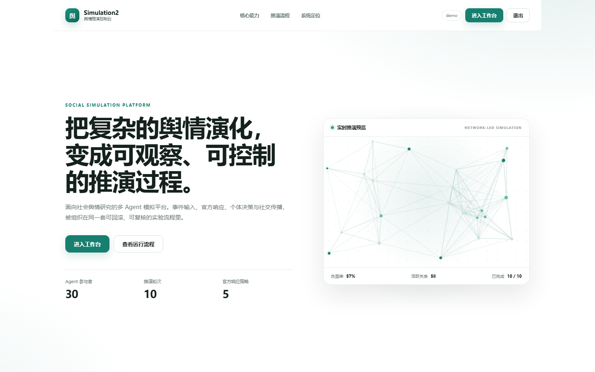
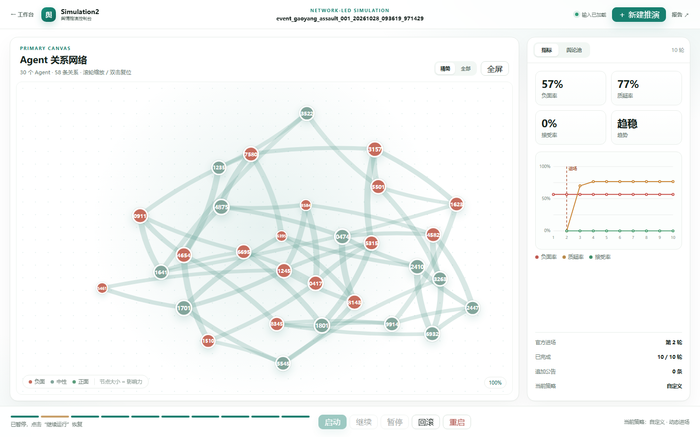
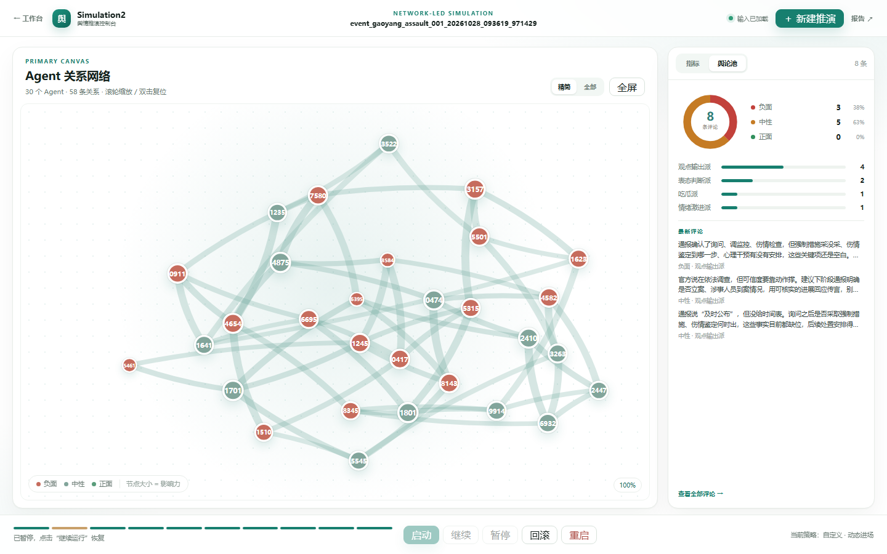
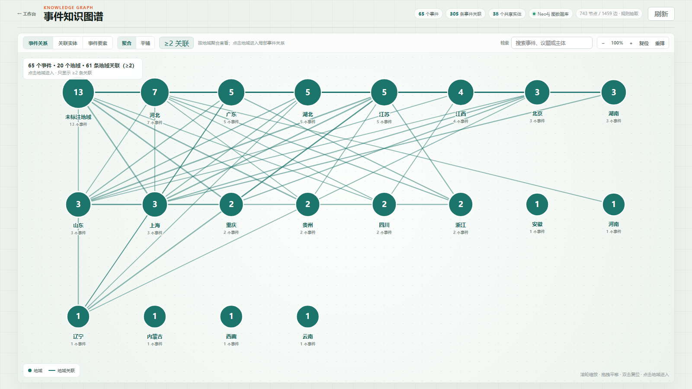
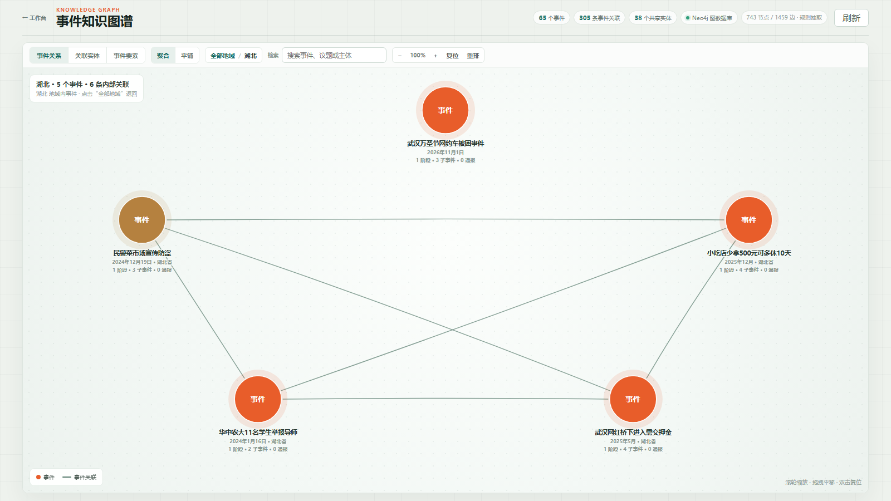
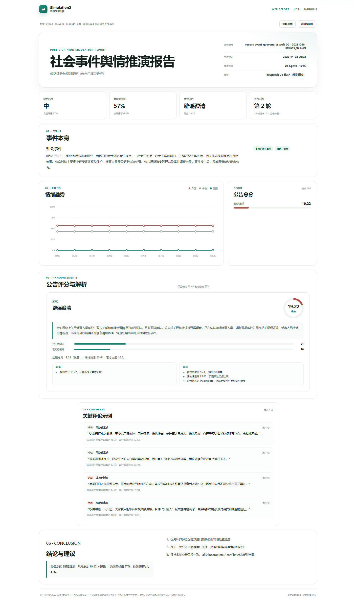
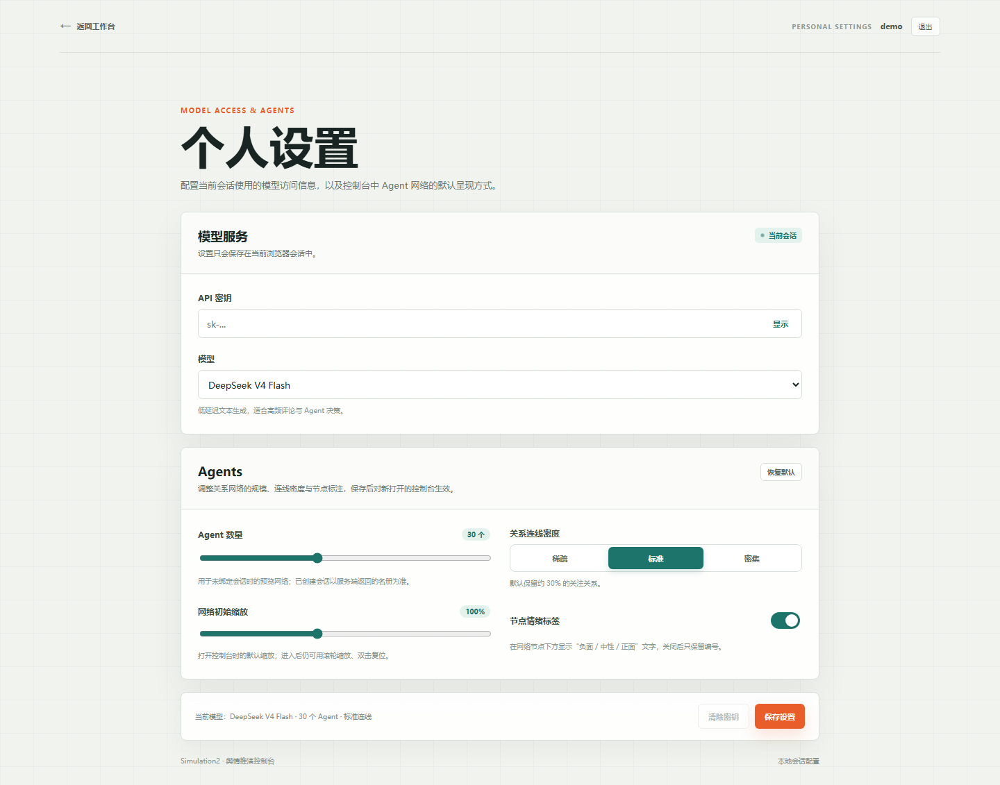
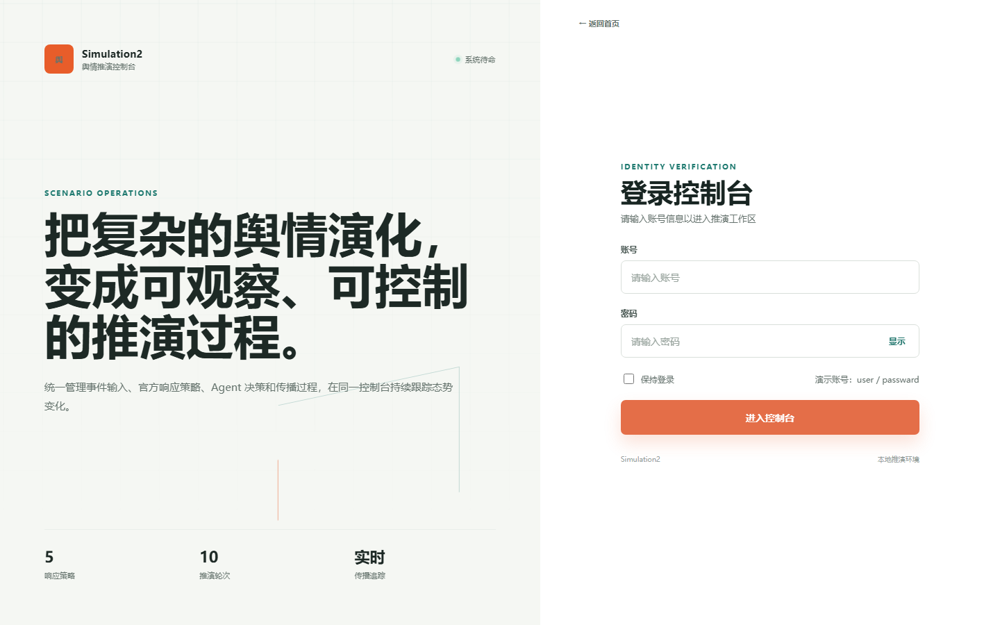

# Future 前端

Vite + Vue 3 前端项目，统一为单套控制台（`/console`）。旧版多版本入口（`/v1`、`/v2`、`/v3`、`/v4`）会重定向到控制台。

## 页面路由

```text
#/        项目主页
#/login   登录页
#/workspace 登录后的工作区选择
#/settings 个人模型设置
#/report   推演结果报告
#/console 控制台
#/history 历史会话记录
#/graph   知识图谱查看
```

## 界面预览

截图统一存放在 `docs/assets/screenshots/`，按页面归档。

### 项目主页



### 控制台





### 知识图谱

事件较少时平铺展示事件关系；事件超过 20 个且覆盖多个地域时，默认按省级
地域聚合，避免 60+ 事件和数百条连线挤在一屏：

- 顶部「聚合 / 平铺」切换视图；
- 「≥2 关联」过滤地域之间的弱关联，切到「全部关联」查看完整关系；
- 点击地域进入该地域的事件关系，左上角「全部地域」返回；
- 搜索会直接平铺匹配的事件，便于跨地域查找；
- 事件详情中的关联事件按全局关系列出，点击可跨地域跳转。





### 报告



### 设置与登录





## 一键启动

直接双击 `start.py` 即可。脚本会自动：

- 检测并复用已经在运行的 Future 后端（校验 `GET /api/health` 的服务标识）；
- 必要时在本仓库 `backend/` 下启动 `python -m app.main.api_server`；
- 启动本项目 Vite 开发服务器；
- 自动选择可用端口并打开浏览器；
- 按 `Ctrl+C` 时同时停止本次启动的前后端进程。

后端固定为本仓库的 `backend/`。只支持通过环境变量调整端口：

```text
SIMULATION2_BACKEND_PORT=8770
SIMULATION2_FRONTEND_PORT=5173
```

启动脚本会校验 `GET /api/health` 返回的 `service` 是否为 `future-backend`，
如果端口被其它服务占用会直接提示，不会静默复用旧后端。

需要 Node.js 20.19+（`package.json` 的 `engines` 要求）。脚本会依次检查
`NODE_EXE`、`PATH`、`Program Files`、用户安装目录以及本机运行时目录
（例如 `.dsh/dsh-runtimes`）；也可以显式设置：

```text
NODE_EXE=C:\path\to\node.exe
```

## 安装与启动

```powershell
pnpm install
pnpm run dev
```

默认地址：

```text
http://127.0.0.1:5173
```

Vite 会把 `/api` 请求代理到 `VITE_BACKEND_PROXY`，默认是：

```text
http://127.0.0.1:8770
```

可复制 `.env.example` 为 `.env` 修改后端地址。生产构建时，也可以设置：

```text
VITE_API_BASE_URL=https://backend.example.com
```

## 构建

```powershell
pnpm run build
pnpm run preview
```

构建产物位于 `dist/`，使用单页 Vue Router 入口。

前端运行时不读取后端源码目录。控制台的 API 请求统一通过
`VITE_BACKEND_PROXY` 或 `VITE_API_BASE_URL` 指向后端服务。

## 工程结构

```text
src/
├─ main.js
├─ App.vue
├─ router/index.js
├─ core/auth.js
├─ core/console.js
├─ core/knowledgeGraph.js
├─ core/settings.js
├─ views/LoginView.vue
├─ views/SettingsView.vue
├─ views/ReportView.vue
├─ views/WorkspaceView.vue
├─ views/PortalView.vue
├─ views/ConsoleView.vue
├─ views/HistoryView.vue
├─ views/GraphView.vue
└─ styles/
```

控制台使用 Vue SFC 模板和 Vue Router；业务状态与 API 方法集中在
`src/core/console.js`。


## 知识图谱

`#/graph` 展示全部历史事件之间的关系，数据来自后端 `GET /api/knowledge-graph`：

- 数据源：`pipelines/kg` 管线从历史复现事件库抽取的 `graph.json`
  （Event / SubEvent / Phase / Topic / Location / Actor / Cause / Consequence /
  Claim / Source / Snapshot）；
- 事件关联：同名 Topic / Actor / Location / Cause / Consequence 被视为事件之间的桥梁，
  后端据此推导事件—事件关联；同一城市的不同写法（河北保定 / 河北省保定市）按省/市后缀归一化；
- 图层：`事件关系`（事件与事件直连）、`关联实体`（展开跨事件共享的议题、主体、地点）、
  `事件要素`（展开每个事件的全部议题、主体、地点、成因与后果）；
- 交互：关键词检索、点击事件查看摘要 / 初始舆情 / 关联事件 / 关键议题，点击实体查看涉及事件，
  以及滚轮缩放、拖拽平移、双击复位和重新布局；
- 单屏布局：页面固定为 `100vh`，图例、统计、事件详情都叠放在画布内部；
- 存储指示：顶部显示「Neo4j 图数据库」（绿色圆点）或「本地快照」；Neo4j 不可用时自动回退；
- 构图与力导向布局集中在 `src/core/knowledgeGraph.js`，页面只负责交互与样式。


## 报告

报告数据由后端生成，前端只负责呈现：

```text
GET  /api/sessions/{experiment_id}/report       读取报告状态与数据
POST /api/sessions/{experiment_id}/report       触发生成（后台线程）
GET  /api/sessions/{experiment_id}/report.pdf   下载 PDF（需先生成报告）
```

状态：`missing`（尚未生成）、`generating`、`ready`、`failed`。

- 报告页工具栏的「下载 PDF」按钮调用 `report.pdf` 接口，由后端按当前报告 JSON
  重新排版，内容与网页一致，不依赖浏览器打印；
- PDF 使用 A4 版式、页眉页脚与页码，章节与公告卡片通过分页控制避免标题孤行、
  卡片断裂和大面积空白；
- 后端从会话产物（逐轮指标、决策历史、评论与传播记录）计算评分，并落盘到 `REPORT_DIR`；
- 报告文件默认位于后端的 `var/reports/`，可用 `SIMULATION_REPORT_DIR` 覆盖；
- 实验目录可用 `SIMULATION_EXPERIMENT_DIR` 覆盖（迁移期间可指向旧目录）；
- 未配置 `DEEPSEEK_API_KEY` 时自动使用规则摘要（`generation.mode = rule`），配置后启用模型分析（`llm`）；
- 入口：`/report?session=<experiment_id>`，控制台与历史会话的「报告」按钮都会带上 `session`。
