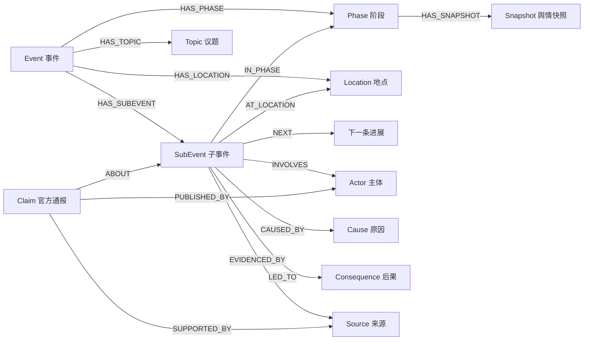

# 事件知识图谱（Neo4j + 大模型抽取）

依托**条件化历史复现使用的真实事件**（`data/historical_replay/events` 下的事件库），
用大模型（或离线规则）抽取结构化要素，建成一张以「事件」为中心的知识图谱，可直接导入 Neo4j，并附带离线可打开的交互图。

```
data/historical_replay/events（真实事件库）
        │  event_manifest / event_input / 公众语境时间线 / 官方通报 / 初始舆情
        ▼
     抽取（大模型或规则）──► 统一 JSON ──► 属性图 ──► Cypher ──► Neo4j
        │                                   │
        │  var/experiments 仅提供指标        ├─ out/graph.cypher（cypher-shell）
        └─ 仅取 mode=historical_replay 批次    └─ out/graph.html（浏览器直看）
```

> 交互式图谱：用浏览器打开 [`out/graph.html`](../../pipelines/kg/out/graph.html)（当前 65 个事件，Canvas 力导向图，支持缩放/搜索/图例过滤）。

## 1. 快速开始

### 1.1 离线规则模式（零依赖，先看效果）

```powershell
py pipelines/kg/pipeline.py
```

不需要装任何第三方包，也不需要大模型 Key。默认读取 `data/historical_replay/events` 的事件库，产物在 `pipelines/kg/out/`，
用浏览器打开 `pipelines/kg/out/graph.html` 即可查看交互图。

### 1.2 大模型抽取

```powershell
$env:DEEPSEEK_API_KEY = "sk-..."          # 或 KG_LLM_API_KEY
py pipelines/kg/pipeline.py --llm                   # 失败会自动回退规则抽取
```

可选环境变量：

| 变量 | 默认值 | 说明 |
| --- | --- | --- |
| `KG_LLM_API_KEY` / `DEEPSEEK_API_KEY` | 无 | API Key，二选一 |
| `KG_LLM_BASE_URL` | `https://api.deepseek.com` | 兼容 OpenAI 的 `/chat/completions` |
| `KG_LLM_MODEL` | `deepseek-chat` | 模型名 |
| `KG_LLM_TIMEOUT` / `KG_LLM_RETRIES` | `120` / `2` | 超时与重试 |

抽取结果按「模型 + 提示词」指纹缓存在 `pipelines/kg/out/cache/<event_id>.json`，重复运行不重复计费；`--refresh` 强制重算。

### 1.3 写入 Neo4j

```powershell
# 方式 A：Docker 起库 + 一键导库
docker compose -f pipelines/kg/docker-compose.yml up -d
py pipelines/kg/pipeline.py --load -p eventkg123

# 方式 B：已有 Neo4j，直接执行生成的 Cypher
cypher-shell -a bolt://localhost:7687 -u neo4j -p <password> -f pipelines/kg/out/graph.cypher

# 方式 C：Neo4j Browser（http://localhost:7474）里粘贴 pipelines/kg/out/graph.cypher 全部内容执行
```

`--load` 会分批执行 `pipelines/kg/out/statements.json`，并打印节点/关系规模与事件子图统计做验收。
完整查询示例见 [`queries.cypher`](../../pipelines/kg/queries.cypher)。

## 2. 产物

| 文件 | 内容 |
| --- | --- |
| `out/extractions.json` | 65 个事件的抽取结果（历史复现 3、历史语料 60、事件库 1、策略运行 1；可人工校对/二次编辑） |
| `out/event_review.md` | 66 个候选事件的逐个判定（入库 65、拒绝 1） |
| `out/graph.json` | 节点-边结构，前端/分析脚本通用 |
| `out/graph.cypher` | 带唯一约束的载入脚本，可直接 `cypher-shell -f` |
| `out/statements.json` | 逐条 Cypher，Python 驱动分批执行用 |
| `out/report.md` | 建图统计、事件脉络、跨事件关联、阶段舆情快照 |
| `out/graph.html` | 零依赖 Canvas 力导向图，支持缩放/拖拽/搜索/图例过滤 |
| `out/cache/` | 大模型返回缓存（仅 `--llm` 模式生成） |

## 3. 数据来源

图谱有三类事件来源，按 `origin` 区分：

| origin | 来源 | 规模 | 说明 |
| --- | --- | ---: | --- |
| `historical_replay` | `data/historical_replay/events/<event_id>/` | 3 | 条件化历史复现真实事件，5 个必需文件缺一不可 |
| `legacy_corpus` | `data/legacy_corpus/event.xlsx` | 60 | 历史语料，单阶段背景事件，无通报/趋势 |
| `event_store` | MongoDB `events` 集合 | 1 | 采集/会话事件（武汉万圣节网约车） |

历史复现事件的目录结构与 `app/historical_replay/event_repository.py` 的
`resolve_event_files()` 保持一致，必需文件缺一不可：

```
data/historical_replay/events/<event_id>/
├── event_manifest.json            # 正式标题、真实趋势源文件与哈希
├── event_input.json               # 第一阶段已公开信息
├── public_context_timeline.json   # 逐轮同期公众语境（必填）
├── official_response_timeline.json# 真实阶段与官方通告
├── initial_opinion.json           # 第一轮人工情绪比例
└── real_trend_source.xlsx         # 人工趋势源（可选）
```

发现逻辑会校验 `manifest/event_input` 的 `event_id` 与目录名一致，并跳过不完整目录；实验产出目录不会被当成历史事件。

| 事件 ID | 标题（manifest） | 阶段数 | 初始舆情（负/中/正） | 指标批次 |
| --- | --- | ---: | --- | --- |
| `event_baoding_driving_school_crash_20261006_001` | 保定驾校车辆碰撞事件 | 7 | 45% / 25% / 30% | 20261010_154112 |
| `event_beiguo_xiantianxia_crash_20260920_002` | 北国先天下广场车辆冲入商场事件 | 3 | 35% / 40% / 25% | 20261013_122213 |
| `event_huxinyu_2022_001` | 胡某宇失联事件 | 8 | 85% / 12.5% / 0% | 20261013_181206 |

指标（`Snapshot`）只从 `var/experiments` 里**根部 `historical_replay_result.json` 且 `mode=historical_replay`** 的批次读取，
回应方案/条件分支实验不参与；同一事件有多次复现时取最近一次。

`Topic` 有两种来源：事件正文中明确的讨论焦点，以及该事件最近一次 historical_replay 批次的 `comment_pool.json` 里的讨论角度
（只补充议题，不引入新事件、不使用方案实验的评论）。

> 说明：`event_gaoyang_assault_001` 是策略运行事件，由后端 `knowledge_graph_sync` 写入
> （`origin=strategy_run`）；重建图谱时从本地快照保留其子图，不重新抽取。

### 3.1 历史语料与事件库事件（2026/11/10 并入）

```powershell
py pipelines/kg/pipeline.py --legacy-corpus data/legacy_corpus/event.xlsx --include-store
```

- 历史语料每条记录只有标题、二手叙述正文和 B 站/抖音视频 ID，因此按**单阶段背景事件**处理：
  只生成 Event / SubEvent / Topic / Location / Source，不生成 Claim 与 Snapshot；
- 事件名、议题、省份、地点由 `pipelines/kg/legacy_corpus.py` 的确定性规则生成（含人工校对表），
  质疑/传闻/举报类句子记为 `discourse / unconfirmed`，不写成官方结论；
- `--include-store` 从 MongoDB `events` 读取每个事件的最新记录，跳过测试占位、正文过短和已入图事件
  （`origin=event_store`）；
- 当前入库结果：**65 个事件 / 743 节点 / 1459 关系**；逐条判定见
  [`out/event_review.md`](../../pipelines/kg/out/event_review.md)。

## 4. 图模型

以事件为枢纽，保留「时间演进 + 事实/说法分离 + 证据可回溯」三条主线：



| 标签 | 关键属性 | 说明 |
| --- | --- | --- |
| `Event` | `event_id, name, summary, topic, valence, time_text, region, location` | 事件主节点 |
| 　 | `origin, manifest_title, run_id, initial_opinion_mode, init_negative_rate, init_neutral_rate, init_positive_rate, real_trend_source` | 出处信息：来自历史事件库、对应复现批次、第一轮人工参照 |
| `SubEvent` | `sub_id, summary, step, kind, status, time_text` | 一条进展；`kind` 区分核实信息/官方通报/公众讨论/正面证据 |
| `Phase` | `phase_name, step, period` | 事件库 `official_response_timeline` 里的真实阶段 |
| `Actor` | `actor_type(person/group/organization), role` | 匿名者用角色名，如「驾驶人」「过路群众」 |
| `Location` | `name` | 同一地点的不同表述会合并 |
| `Topic` | `name, focus` | 讨论角度/公众议题 |
| `Cause` / `Consequence` | `text` | 只在材料明确给出时生成 |
| `Claim` | `text, publisher, published_at, status` | 官方通报原文；`status` 沿用材料口径（clear→confirmed，其余→partial） |
| `Source` | `ref` | 证据出处（文件:表:单元格、URL 等） |
| `Snapshot` | `trend, negative_rate, question_rate, accept_rate` | 该阶段历史复现批次的舆情指标 |

**跨事件如何连起来**：`Actor`、`Topic`、`Location`、`Cause`、`Consequence`、`Source` 按名称/文本全局合并；
`Event`、`SubEvent`、`Phase`、`Claim`、`Snapshot` 按事件隔离（`id` 带事件前缀）。
因此「事故原因」「责任认定」「公安机关」这类节点会把不同事件连在一起，可直接查共享议题和关联路径。

## 5. 大模型抽取协议

- 提示词在 [`ontology.py`](../../pipelines/kg/ontology.py) 的 `SYSTEM_PROMPT`，要求模型只输出一个 JSON（`response_format: json_object`）。
- 抽取字段：`event / phases / sub_events / actors / locations / topics / claims`，详见提示词中的结构示例。
- **严格校验**：`validate_extraction()` 会检查标签、枚举、ID 唯一性、引用是否存在；非法项丢弃并记录警告，个别脏数据不会污染整张图。
- **失败回退**：单事件调用失败只影响该事件（自动回退规则抽取），不会中断整批。
- 大模型只负责「读材料 → 出结构化要素」，不生成 Cypher；Cypher 由本地模板统一生成，避免模型直接改写图结构。

规则基线做的事：按句/分句切分 + 关键词角色词典 + 地点后缀 + 原因/后果句式 + 评论角度，稳定但召回有限；
从 `extraction_mode` 字段可以区分每次产物来自 `heuristic` 还是 `llm`。

## 6. 常用查询

```cypher
// 某事件的阶段时间线 + 舆情趋势
MATCH (e:Event {event_id: 'event_huxinyu_2022_001'})-[:HAS_PHASE]->(p:Phase)
OPTIONAL MATCH (p)<-[:IN_PHASE]-(s:SubEvent)
OPTIONAL MATCH (p)-[:HAS_SNAPSHOT]->(sn:Snapshot)
RETURN p.step, p.phase_name, collect(DISTINCT s.summary)[0..3], sn.negative_rate
ORDER BY p.step;
```

```cypher
// 哪些议题跨事件复用（≥2 个事件）
MATCH (t:Topic)<-[:HAS_TOPIC]-(e:Event)
WITH t, collect(DISTINCT e.name) AS events
WHERE size(events) >= 2
RETURN t.name, size(events), events ORDER BY size(events) DESC;
```

```cypher
// 两个事件之间的关联路径
MATCH (a:Event {event_id:'event_baoding_driving_school_crash_20261006_001'}),
      (b:Event {event_id:'event_huxinyu_2022_001'})
MATCH p = shortestPath((a)-[*..8]-(b))
RETURN [n IN nodes(p) | n.name], [r IN relationships(p) | type(r)];
```

更多见 [`queries.cypher`](../../pipelines/kg/queries.cypher)（含时间线、因果链、通报溯源、跨事件路径、度中心性等 12 条，已在 Neo4j 5.26 上逐条执行验证）。

## 7. 目录结构

```
pipelines/kg/
├── pipeline.py      # CLI：发现历史事件 → 抽取 → 建图 → 出图 →（可选）导库
├── ontology.py      # 本体（标签/关系）+ 大模型提示词 + 结果校验
├── extract.py       # 历史事件库发现、指标挂载、规则抽取、大模型抽取、阶段快照
├── legacy_corpus.py # 旧事件语料表（event.xlsx）的确定性抽取
├── event_store.py   # MongoDB events 集合事件的读取与筛选
├── snapshot_merge.py# 策略运行事件子图与本地快照的合并
├── llm.py           # OpenAI/DeepSeek 兼容客户端（仅标准库，带缓存与重试）
├── graph.py         # 规范化建图、Cypher 生成、Markdown 报告
├── viz.py           # 零依赖交互式图谱页面
├── load.py          # neo4j 驱动分批写入 + 导库验收
├── queries.cypher   # 常用查询
├── docker-compose.yml
└── out/             # 生成产物
```

## 8. 常用命令

```powershell
py pipelines/kg/pipeline.py --event event_huxinyu_2022_001      # 只跑一个事件（按 event_id 子串匹配）
py pipelines/kg/pipeline.py --llm --refresh                     # 强制重新调用大模型
py pipelines/kg/pipeline.py --reuse                             # 复用 out/extractions.json 重画图
py pipelines/kg/pipeline.py --no-viz                            # 只要 Cypher/报告
py pipelines/kg/pipeline.py --events data/historical_replay/events --experiments var/experiments
py pipelines/kg/pipeline.py --load --uri bolt://localhost:7687 -u neo4j -p eventkg123
```

## 9. 与后端联动：策略运行自动入库

Neo4j 是事件图谱的主存储，后端 `GET /api/knowledge-graph` 优先读取它：

- 首次读取时，后端会把本地快照中尚未进入 Neo4j 的事件 MERGE 补录；
- Neo4j 不可用时自动回退到本地快照，页面顶部显示「本地快照」。

**策略运行事件**（例如 `event_gaoyang_assault_001`）不来自历史事件库：
每次单方案会话跑完或全部策略批次结束，后端会先用本管线的规则抽取，从该
会话的事件输入、公告时间线/所选方案和 `comment_pool.json` 的讨论角度生成
事件子图，写入本地快照；Neo4j 可用时再检查 `Event.event_id` 是否已存在，
不存在则 MERGE 进 Neo4j。已存在的事件不会重复写入。

事件输入优先读本地 `event_input.json`；文件不存在时从 MongoDB 读取
（`MONGO_WRITE_JSON_MIRROR=0` 时事件只存在 MongoDB）。前端改正文时后端会
按正文哈希生成新的 `event_id`，避免新事件继续沿用默认事件 ID。

- 抽取入口：`app/application/knowledge_graph_sync.py`；状态包括
  `added / exists / stored_locally / failed`；
- 写入方式：参数化 MERGE（`app/infrastructure/graph/neo4j_repository.py`），
  本地 Neo4j 走事务接口，Neo4j Aura 走 Query API，不依赖 neo4j 驱动；
- 策略事件默认 `origin=strategy_run`，语料事件 `origin=legacy_corpus`，事件库事件
  `origin=event_store`；页面事件详情分别标注「策略运行事件」「历史语料事件」「事件库事件」，
  其余为「历史复现事件」；
- 与历史事件共享 `Actor / Topic / Location` 后，会出现在事件关系图上。

手动导入历史图谱：`py backend/scripts/seed_knowledge_graph.py`。

## 10. 局限与扩展

- 历史复现事件库只有 3 个真实事件；图谱中的 60 个历史语料事件和 1 个事件库事件没有阶段时间线、
  官方通报与真实趋势，不能作为历史复现输入。新增复现事件仍需按第 3 节结构放入
  `data/historical_replay/events/<event_id>/` 并通过 `event_repository.resolve_event_files()` 校验。
- 规则模式依赖关键词，长句、隐含因果、指代（“该车辆”“涉事人员”）会漏抽；换成 `--llm` 明显更完整。
- 官方通报的 `status` 直接沿用材料里的 `official_statement_status`，不代表对真实事件的独立判断。
- `Snapshot` 是历史复现批次的 Agent 统计口径，不是全网真实舆情；没有对应批次的指标时不生成快照。
- 事件材料的来源引用是「文件:表:单元格」形式，`Source` 节点只保留字符串，不做文件级校验。
- 策略运行事件默认使用规则抽取，不调用大模型，也不生成历史复现的阶段快照；如需更完整的要素/快照，可在 `knowledge_graph_sync` 中接入 LLM 抽取与批次指标。
- 可扩展方向：加 `Agent/评论` 节点做观点传播子图、用 APOC 做图算法（社区发现、中心性）、把抽取结果回写为事件仿真输入。
